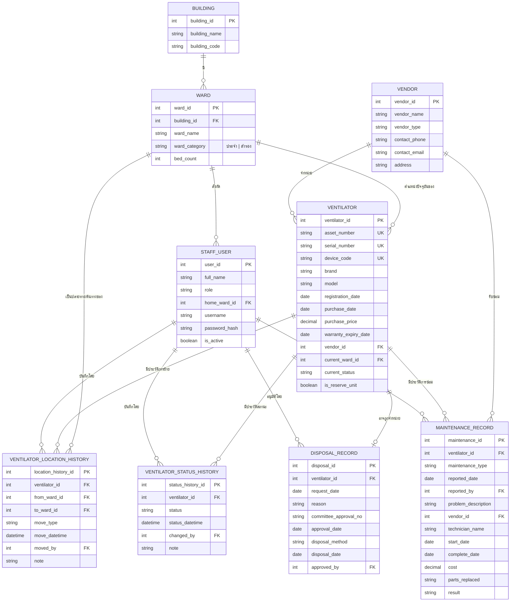

# ฐานข้อมูลเครื่องช่วยหายใจ โรงพยาบาลมหาสารคาม
## Mahasarakham Ventilator Database Management — Data Model

## 1. บริบทและวัตถุประสงค์

ปัจจุบันศูนย์เครื่องมือ (Equipment Center) โรงพยาบาลมหาสารคาม เก็บทะเบียนเครื่องช่วยหายใจ (ventilator)
แบบข้อมูลนิ่ง (static registry) ได้แก่ เลขครุภัณฑ์, serial number, ID เครื่อง, brand, model, วันที่ลงทะเบียน
แต่ยังไม่มีระบบที่:

- ติดตามตำแหน่ง/สถานะเครื่องแบบ real-time (ประจำหอผู้ป่วย / สำรองที่ตึก / สำรองที่ศูนย์เครื่องมือ / ส่งซ่อม / จำหน่ายแล้ว)
- บันทึกประวัติการเคลื่อนย้ายเครื่องระหว่างหน่วยงาน
- จัดการวงจรการซ่อมบำรุง (แจ้งซ่อม → ซ่อม → ผลการซ่อม)
- จัดการกระบวนการจำหน่ายครุภัณฑ์ (write-off/disposal)

เอกสารนี้กำหนด entity, attribute และความสัมพันธ์ (ER model) เพื่อใช้เป็นฐานสำหรับพัฒนาเว็บแอปพลิเคชันในขั้นถัดไป

## 2. ข้อมูลอ้างอิงหน่วยงาน (Master data: Building / Ward)

ระบบต้องรองรับโครงสร้างหน่วยงาน 2 ระดับ คือ **อาคาร (Building)** และ **หอผู้ป่วย/จุดวาง (Ward/Location)**
โดยจุดวางแบ่งเป็น 2 ประเภท: `ward_category = ประจำ` (มี ventilator ประจำเท่าจำนวนเตียง) และ `ward_category = สำรอง` (คลังสำรองของอาคาร/ศูนย์เครื่องมือ)

| อาคาร (Building) | จุดวางสำรอง (Reserve) | หอผู้ป่วยที่มีเครื่องประจำ (Dedicated wards) |
|---|---|---|
| ศูนย์เครื่องมือ | ✅ สำรองส่วนกลาง | – |
| อาคารบำบัดรักษา | ✅ | MICU1, MICU2, MICU3, CCU |
| อาคารอายุรกรรม | ✅ | หอผู้ป่วยชาย1, หอผู้ป่วยชาย2, หอผู้ป่วยหญิง1, หอผู้ป่วยหญิง2, หอผู้ป่วยโรคหลอดเลือดสมอง |
| อาคารอุบัติเหตุฉุกเฉิน | ✅ | SICU, TICU, หอผู้ป่วยอุบัติเหตุฉุกเฉิน, หอผู้ป่วยศัลยกรรมหญิง |
| อาคารทองดี | ✅ | PICU |
| อาคาร 60 ปี | ✅ | ศัลยกรรมชาย |

หมายเหตุ: จุดวางสำรอง (สำรอง) ก็ถูกโมเดลเป็นแถวหนึ่งใน `WARD` เช่นกัน (เช่น "สำรอง-อาคารอายุรกรรม") เพื่อให้ ventilator ทุกเครื่องมี `current_ward_id` เสมอ ไม่ว่าจะประจำหอผู้ป่วยจริงหรืออยู่ในคลังสำรอง

## 3. Entity และ Attribute

### 3.1 BUILDING (อาคาร)
| Attribute | ชนิดข้อมูล | คำอธิบาย |
|---|---|---|
| building_id (PK) | INT | รหัสอาคาร |
| building_name | VARCHAR | ชื่ออาคาร เช่น อาคารบำบัดรักษา |
| building_code | VARCHAR | รหัสย่อ |

### 3.2 WARD (หอผู้ป่วย / จุดวาง)
| Attribute | ชนิดข้อมูล | คำอธิบาย |
|---|---|---|
| ward_id (PK) | INT | รหัสหอผู้ป่วย/จุดวาง |
| building_id (FK) | INT | อ้างอิง BUILDING |
| ward_name | VARCHAR | ชื่อหอผู้ป่วย เช่น MICU1, PICU, สำรอง-ศูนย์เครื่องมือ |
| ward_category | ENUM | `ประจำ` \| `สำรอง` |
| bed_count | INT (nullable) | จำนวนเตียงที่ต้องมีเครื่องประจำ (เฉพาะ ward_category = ประจำ) |

### 3.3 VENDOR (บริษัทผู้จำหน่าย/ผู้รับซ่อม)
| Attribute | ชนิดข้อมูล | คำอธิบาย |
|---|---|---|
| vendor_id (PK) | INT | รหัสบริษัท |
| vendor_name | VARCHAR | ชื่อบริษัท |
| vendor_type | ENUM | `ผู้จำหน่าย` \| `ผู้รับซ่อม` \| `ทั้งสอง` |
| contact_phone | VARCHAR | เบอร์ติดต่อ |
| contact_email | VARCHAR | อีเมล |
| address | TEXT | ที่อยู่ |

### 3.4 STAFF_USER (ผู้ใช้งานระบบ)
| Attribute | ชนิดข้อมูล | คำอธิบาย |
|---|---|---|
| user_id (PK) | INT | รหัสผู้ใช้ |
| full_name | VARCHAR | ชื่อ-สกุล |
| role | ENUM | `เจ้าหน้าที่ศูนย์เครื่องมือ` \| `พยาบาล/เจ้าหน้าที่หอผู้ป่วย` \| `ผู้ดูแลระบบ` |
| home_ward_id (FK, nullable) | INT | หอผู้ป่วยต้นสังกัด |
| username | VARCHAR | ชื่อผู้ใช้ล็อกอิน |
| password_hash | VARCHAR | รหัสผ่าน (เข้ารหัส) |
| is_active | BOOLEAN | สถานะการใช้งานบัญชี |

### 3.5 VENTILATOR (เครื่องช่วยหายใจ — master data)
| Attribute | ชนิดข้อมูล | คำอธิบาย |
|---|---|---|
| ventilator_id (PK) | INT | รหัสภายในระบบ |
| asset_number | VARCHAR (unique) | เลขครุภัณฑ์ |
| serial_number | VARCHAR (unique) | Serial number จากผู้ผลิต |
| device_code | VARCHAR (unique) | ID อย่างง่ายที่ติดบนตัวเครื่อง |
| brand | VARCHAR | ยี่ห้อ |
| model | VARCHAR | รุ่น |
| registration_date | DATE | วันที่ลงทะเบียนครุภัณฑ์ |
| purchase_date | DATE (nullable) | วันที่จัดซื้อ |
| purchase_price | DECIMAL (nullable) | ราคาจัดซื้อ |
| warranty_expiry_date | DATE (nullable) | วันหมดประกัน |
| vendor_id (FK, nullable) | INT | บริษัทผู้จำหน่าย |
| current_ward_id (FK) | INT | ตำแหน่งปัจจุบัน (denormalized สำหรับ dashboard real-time) |
| current_status | ENUM | สถานะปัจจุบัน (denormalized, ดู 4.1) |
| is_reserve_unit | BOOLEAN | true = เครื่องสำรอง, false = เครื่องประจำหอผู้ป่วย |

### 3.6 VENTILATOR_LOCATION_HISTORY (ประวัติการเคลื่อนย้าย)
| Attribute | ชนิดข้อมูล | คำอธิบาย |
|---|---|---|
| location_history_id (PK) | INT | รหัสรายการ |
| ventilator_id (FK) | INT | เครื่องที่เคลื่อนย้าย |
| from_ward_id (FK, nullable) | INT | ต้นทาง |
| to_ward_id (FK) | INT | ปลายทาง |
| move_type | ENUM | `จ่ายประจำ` \| `เบิกสำรอง/ยืม` \| `คืนคลัง` \| `ส่งซ่อม` \| `รับคืนจากซ่อม` \| `จำหน่าย` |
| move_datetime | DATETIME | วันเวลาที่ย้าย |
| moved_by (FK) | INT | ผู้ทำรายการ (STAFF_USER) |
| note | TEXT | หมายเหตุ |

### 3.7 VENTILATOR_STATUS_HISTORY (ประวัติสถานะ)
| Attribute | ชนิดข้อมูล | คำอธิบาย |
|---|---|---|
| status_history_id (PK) | INT | รหัสรายการ |
| ventilator_id (FK) | INT | เครื่อง |
| status | ENUM | ดูรายการสถานะ 4.1 |
| status_datetime | DATETIME | วันเวลาที่เปลี่ยนสถานะ |
| changed_by (FK) | INT | ผู้บันทึก (STAFF_USER) |
| note | TEXT | หมายเหตุ |

### 3.8 MAINTENANCE_RECORD (ประวัติการแจ้งซ่อม/บำรุงรักษา)
| Attribute | ชนิดข้อมูล | คำอธิบาย |
|---|---|---|
| maintenance_id (PK) | INT | รหัสใบแจ้งซ่อม |
| ventilator_id (FK) | INT | เครื่องที่ซ่อม |
| maintenance_type | ENUM | `PM (บำรุงรักษาตามแผน)` \| `CM (ซ่อมเมื่อชำรุด)` |
| reported_date | DATE | วันที่แจ้งซ่อม |
| reported_by (FK) | INT | ผู้แจ้ง (STAFF_USER) |
| problem_description | TEXT | อาการ/ปัญหา |
| vendor_id (FK, nullable) | INT | ผู้รับซ่อม (ภายใน/ภายนอก) |
| technician_name | VARCHAR (nullable) | ชื่อช่างผู้ซ่อม |
| start_date | DATE (nullable) | วันเริ่มซ่อม |
| complete_date | DATE (nullable) | วันซ่อมเสร็จ |
| cost | DECIMAL (nullable) | ค่าใช้จ่าย |
| parts_replaced | TEXT (nullable) | อะไหล่ที่เปลี่ยน |
| result | ENUM | `ซ่อมสำเร็จ` \| `รออะไหล่` \| `ซ่อมไม่ได้/รอจำหน่าย` |

### 3.9 DISPOSAL_RECORD (ประวัติการจำหน่ายครุภัณฑ์)
| Attribute | ชนิดข้อมูล | คำอธิบาย |
|---|---|---|
| disposal_id (PK) | INT | รหัสรายการจำหน่าย |
| ventilator_id (FK, unique) | INT | เครื่องที่จำหน่าย (1 เครื่องจำหน่ายได้ครั้งเดียว) |
| request_date | DATE | วันที่เสนอขอจำหน่าย |
| reason | TEXT | เหตุผล (ชำรุดเกินคุ้มค่าซ่อม/ล้าสมัย/อื่นๆ) |
| committee_approval_no | VARCHAR | เลขที่คำสั่งแต่งตั้งกรรมการ/เลขที่อนุมัติ |
| approval_date | DATE | วันที่อนุมัติ |
| disposal_method | ENUM | `ขาย` \| `ทำลาย` \| `บริจาค` \| `แปรสภาพ` |
| disposal_date | DATE (nullable) | วันที่จำหน่ายจริง |
| approved_by (FK) | INT | ผู้อนุมัติ (STAFF_USER) |

## 4. ค่าคงที่ (Enumerations)

### 4.1 สถานะเครื่อง (current_status / VENTILATOR_STATUS_HISTORY.status)
- `พร้อมใช้งาน` — Available
- `กำลังใช้งานกับผู้ป่วย` — In use
- `รอซ่อม` — Awaiting repair
- `กำลังซ่อมบำรุง` — Under maintenance
- `ชำรุด/รอพิจารณาจำหน่าย` — Damaged / pending disposal review
- `จำหน่ายแล้ว` — Disposed (terminal state)

## 5. ความสัมพันธ์ระหว่าง Entity (Relationships)

- BUILDING (1) — (N) WARD
- WARD (1) — (N) VENTILATOR *(current_ward_id — ตำแหน่งปัจจุบัน)*
- WARD (1) — (N) VENTILATOR_LOCATION_HISTORY *(to_ward_id / from_ward_id)*
- WARD (1) — (N) STAFF_USER *(home_ward_id)*
- VENTILATOR (1) — (N) VENTILATOR_LOCATION_HISTORY
- VENTILATOR (1) — (N) VENTILATOR_STATUS_HISTORY
- VENTILATOR (1) — (N) MAINTENANCE_RECORD
- VENTILATOR (1) — (0..1) DISPOSAL_RECORD
- VENDOR (1) — (N) VENTILATOR *(ผู้จำหน่ายตอนซื้อ)*
- VENDOR (1) — (N) MAINTENANCE_RECORD *(ผู้รับซ่อม)*
- STAFF_USER (1) — (N) VENTILATOR_LOCATION_HISTORY *(moved_by)*
- STAFF_USER (1) — (N) VENTILATOR_STATUS_HISTORY *(changed_by)*
- STAFF_USER (1) — (N) MAINTENANCE_RECORD *(reported_by)*
- STAFF_USER (1) — (N) DISPOSAL_RECORD *(approved_by)*

## 6. ER Diagram

## 7. Seed data ที่ต้องเตรียมก่อนขึ้นระบบ

**BUILDING**: ศูนย์เครื่องมือ, อาคารบำบัดรักษา, อาคารอายุรกรรม, อาคารอุบัติเหตุฉุกเฉิน, อาคารทองดี, อาคาร 60 ปี

**WARD** (ward_category = ประจำ):
- อาคารอายุรกรรม: หอผู้ป่วยชาย1, หอผู้ป่วยชาย2, หอผู้ป่วยหญิง1, หอผู้ป่วยหญิง2, หอผู้ป่วยโรคหลอดเลือดสมอง
- อาคารบำบัดรักษา: MICU1, MICU2, MICU3, CCU
- อาคารอุบัติเหตุฉุกเฉิน: SICU, TICU, หอผู้ป่วยอุบัติเหตุฉุกเฉิน, หอผู้ป่วยศัลยกรรมหญิง
- อาคาร 60 ปี: ศัลยกรรมชาย
- อาคารทองดี: PICU

**WARD** (ward_category = สำรอง — 1 แถวต่ออาคาร): สำรอง-ศูนย์เครื่องมือ, สำรอง-อาคารบำบัดรักษา, สำรอง-อาคารอายุรกรรม, สำรอง-อาคารอุบัติเหตุฉุกเฉิน, สำรอง-อาคารทองดี, สำรอง-อาคาร60ปี

## 8. ขอบเขตที่ยังไม่รวมไว้ (ตั้งใจตัดออกในเวอร์ชันนี้)

- การผูกเครื่องกับผู้ป่วยรายบุคคล (patient-level usage log) — ไม่ได้ระบุในความต้องการเริ่มต้น
- Consumable/อะไหล่คงคลัง แยกเป็นระบบสต๊อกอะไหล่
- แจ้งเตือนอัตโนมัติ (PM due, ประกันใกล้หมด) — เป็น business logic ชั้นแอปพลิเคชัน ไม่ใช่ schema

## 9. ขั้นตอนถัดไป

นำโมเดลนี้ไปพัฒนาเป็นเว็บแอปพลิเคชัน (แนะนำ: backend REST/DB เชิงสัมพันธ์ เช่น PostgreSQL + framework ตามความถนัด, frontend สำหรับ dashboard แสดงสถานะ real-time ต่อหอผู้ป่วย/อาคาร)
